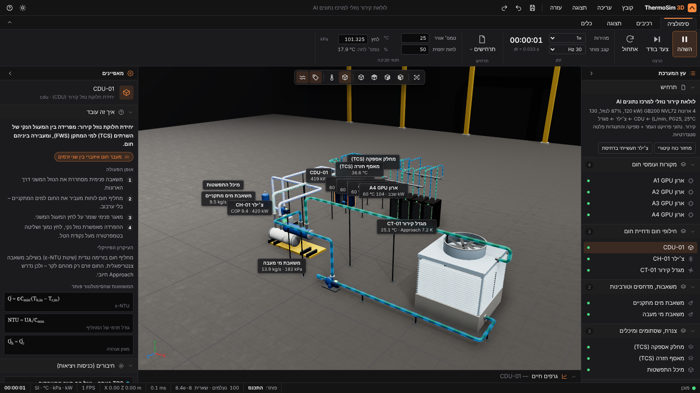
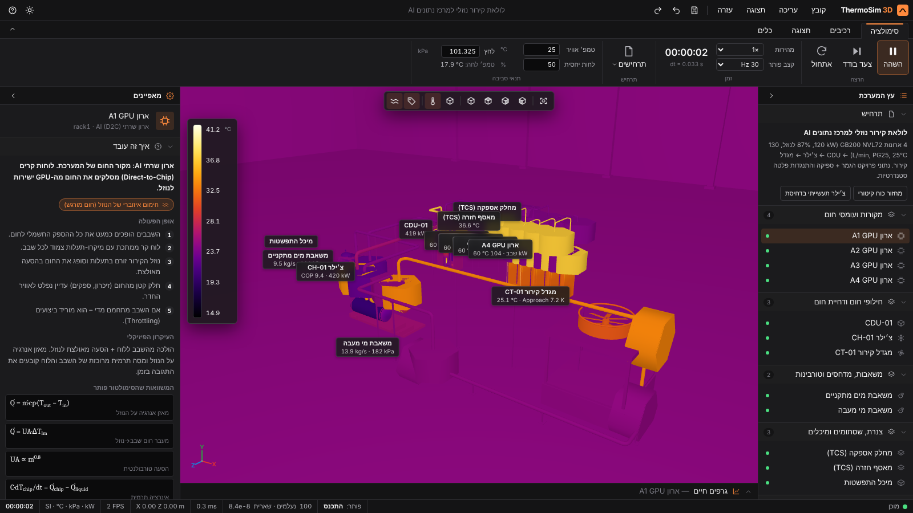
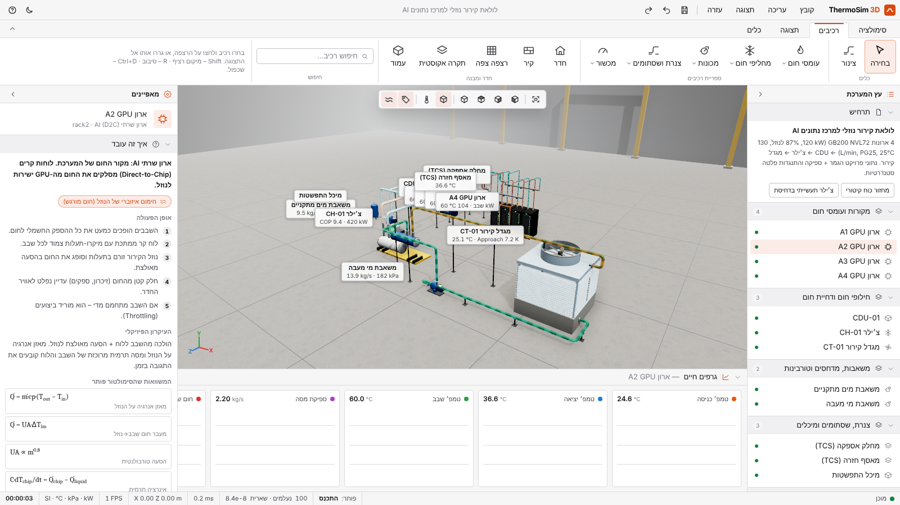
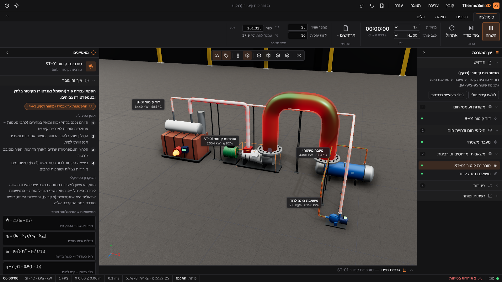
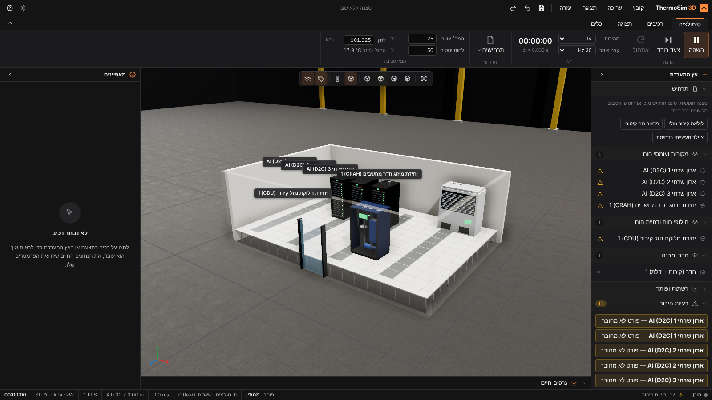

<div align="center">

# ThermoSim 3D

**A browser-based 3D simulator for thermodynamic and liquid-cooling systems**

Build a plant from real components, connect them with pipes, and watch a fully coupled solver compute pressures, flows and temperatures live, in a realistic or FLIR-style thermal view.




</div>

---

## Try it in 10 seconds

Download **[`release/ThermoSim3D.html`](release/ThermoSim3D.html)** and double-click it.
The whole app (3D engine, physics, fluid tables, scenarios) is inside that single file. No install, no internet needed. Works best in Chrome or Edge.

> On older PCs without a graphics card, choose **View → Graphics quality → Fast**.

---

## Highlights

| | |
|---|---|
| **Coupled network solver** | Every loop is solved simultaneously (Levenberg–Marquardt on a sparse Jacobian) with implicit-Euler thermal inertia. Pressure, mass flow and enthalpy at every node. |
| **Real fluid properties** | Tables generated with CoolProp: water/steam (IAPWS-95), R134a, R410A, MEG 30 %, **PG25**, ideal-gas air. Full two-phase model. |
| **29 components** | Pumps, compressors, turbines, boiler, condenser, evaporator, chiller, cooling tower, dry cooler, CRAH, CDU, plate and shell-and-tube heat exchangers, AI racks, valves, sensors, tanks, and more. |
| **"How it works" for each part** | Click any component to see its purpose, operating steps, the governing thermodynamic process and the exact equations the solver uses. |
| **Safety warnings** | Boiling, freezing, over-pressure, cavitation, chip over-temperature, compressor discharge temperature and more show in red with a ⚠ sign. |
| **Thermal camera** | FLIR-style IR rendering (Ironbow / Rainbow / White-hot) with auto-ranging legend. |
| **CAD-style workflow** | SolidWorks-like ribbon and docks, undo/redo, duplicate, port snapping, connection suggestions, editable pipe routes with elbows. |
| **Room builder** | Rooms, walls (click-to-draw), raised floors and ceilings. The wall nearest the camera fades out so you can always see inside. |
| **Save and share** | `Ctrl+S` saves a self-contained `.html`: opening it resumes exactly where you stopped, including the camera. |
| **Light / dark theme** | Full Hebrew RTL interface. |

---

## Screenshots

<table>
<tr>
<td width="50%"><br><sub><b>Thermal camera</b>: live surface temperatures of the GB200 racks and CDU loop</sub></td>
<td width="50%"><br><sub><b>Light theme</b>: component library, live charts and properties</sub></td>
</tr>
<tr>
<td width="50%"><br><sub><b>Steam Rankine cycle</b>: boiler, turbine, condenser and feed pump</sub></td>
<td width="50%"><br><sub><b>Room builder</b>: raised floor, auto-fading walls, racks and a CRAH</sub></td>
</tr>
</table>

---

## Built-in scenarios

| Scenario | What it shows |
|---|---|
| **AI data-center liquid cooling** | 4 × NVIDIA GB200 NVL72 racks (120 kW each, 87 % to liquid, 130 L/min PG25 at 25 °C) → CDU → chiller → cooling tower. Three coupled loops. |
| **Steam Rankine power cycle** | Boiler → steam turbine → surface condenser → feed pump, with IAPWS-95 steam. |
| **Vapour-compression chiller** | Compressor → condenser → TXV → evaporator with R134a, superheat control. |

---

## Controls

| Action | Mouse / key |
|---|---|
| Look around | Left-drag on empty space |
| Move through the scene | `W` `A` `S` `D` (along the view direction), `Q` / `E` down / up, `Shift` faster |
| Rotate / pan / zoom (SolidWorks style) | Middle-drag / `Ctrl` + middle-drag / wheel |
| Fit to screen · standard views | `F` or double-click the wheel · `Ctrl+1…7`, `Space` for the view cube |
| Select · move component | Click · drag |
| Rotate · duplicate · delete | `R` · `Ctrl+D` · `Del` |
| Pipe tool | `P`: click an outlet, click the floor to add bends, click an inlet |
| Undo · redo | `Ctrl+Z` · `Ctrl+Y` |
| Save · open project | `Ctrl+S` · `Ctrl+O` |
| Thermal view | `I` |
| Run / pause · single step | `Shift+Space` · `N` |
| All shortcuts | `F1` |

---

## Run from source

```bash
npm install
npm run dev              # http://localhost:5173  (?t=dc | rankine | vcc to choose the start scenario)
npm run build:single     # builds the one-file app into dist-single/index.html
```

**Checks**

```bash
npm run typecheck
npm run test:props       # fluid properties vs. published reference points
npm run test:templates   # headless solve of the three scenarios
npm run test:components  # convergence of the newer components
```

To regenerate the fluid tables (needs Python with CoolProp): `python scripts/gen_tables.py`.

---

## How it is built

```
src/
├── physics/              pure TypeScript, no rendering
│   ├── fluidProperties.ts    property lookup (CoolProp tables in data/)
│   ├── thermodynamics.ts     Churchill friction, ε-NTU, isentropic work, psychrometrics
│   ├── components.ts         equation set of every component
│   ├── physicsEngine.ts      network compiler + simultaneous solver
│   └── templates.ts          the three scenarios
├── render/               React Three Fiber scene
│   ├── ProceduralComponents.tsx  detailed procedural 3D models
│   ├── Pipes.tsx                 routed pipes, elbows, insulation, flow indicator
│   ├── ThermalShader.ts          FLIR-style GLSL
│   └── SceneView.tsx             camera, placement, dragging, pipe routing
├── ui/                   Hebrew RTL interface (ribbon, docks, panels, safety checks, save/load)
└── runtime.ts            simulation state, undo/redo, project files
```

The physics layer has no UI dependencies, so it can be tested and run headless.

**Units:** SI throughout (kPa, K / °C, kg/s, kW, kJ/kg).

**Custom 3D models:** every part is procedural by default. You can load your own `.glb` per component type from **Tools → Model manager**. See [`docs/ASSET_CHECKLIST.md`](docs/ASSET_CHECKLIST.md).

---

## Sources

* Fluid properties: [CoolProp](http://www.coolprop.org/) (IAPWS-95 for water; Melinder correlations for glycol mixtures).
* GB200 NVL72 rack data: HPE QuickSpecs and QCT (≈ 115 kW to liquid + 17 kW to air at full load, ≈ 130 L/min per rack).

---

<div align="center">
<sub>Developed by Tomer Schwartz, Mechanical Engineering (renewable &amp; alternative energy), SCE, with Claude.</sub>
</div>
